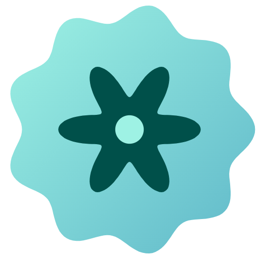
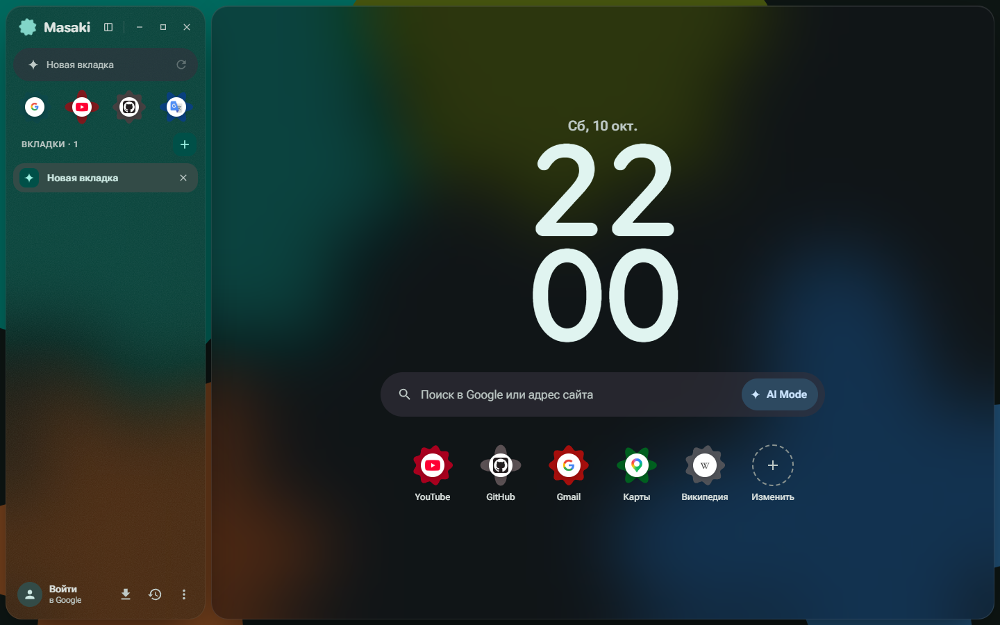
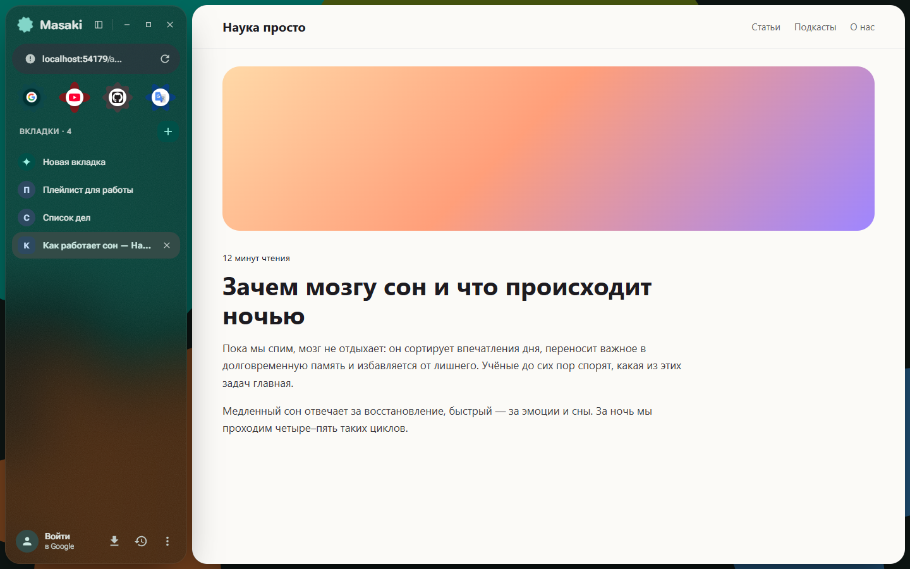
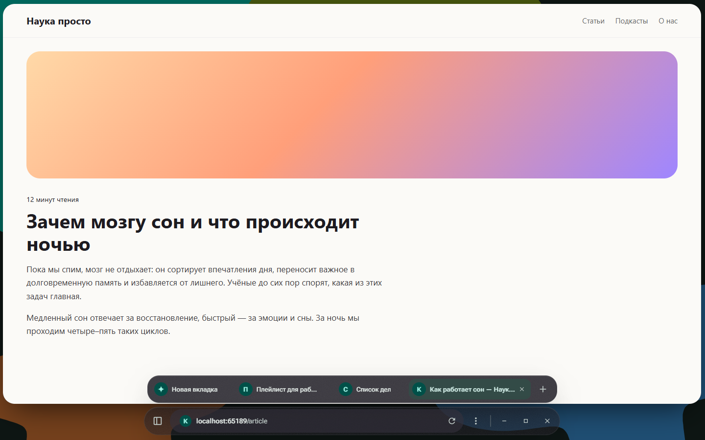
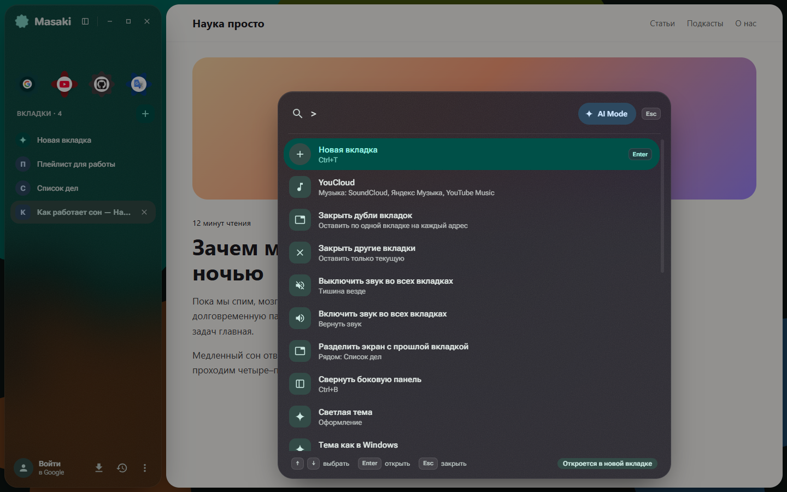
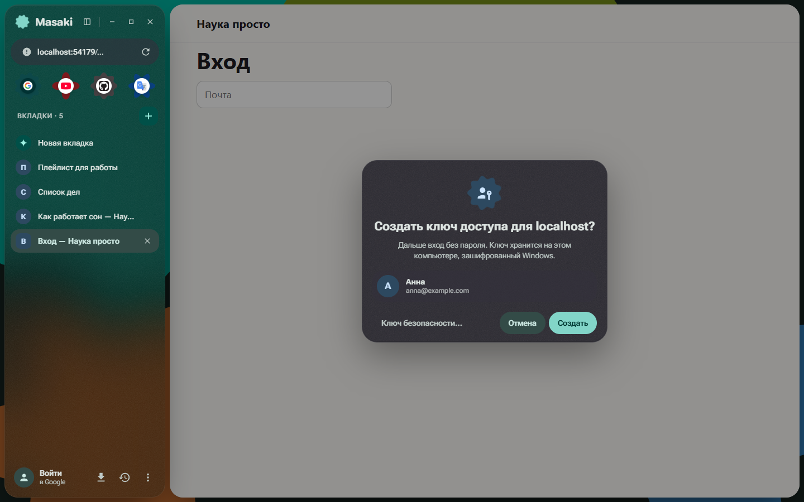
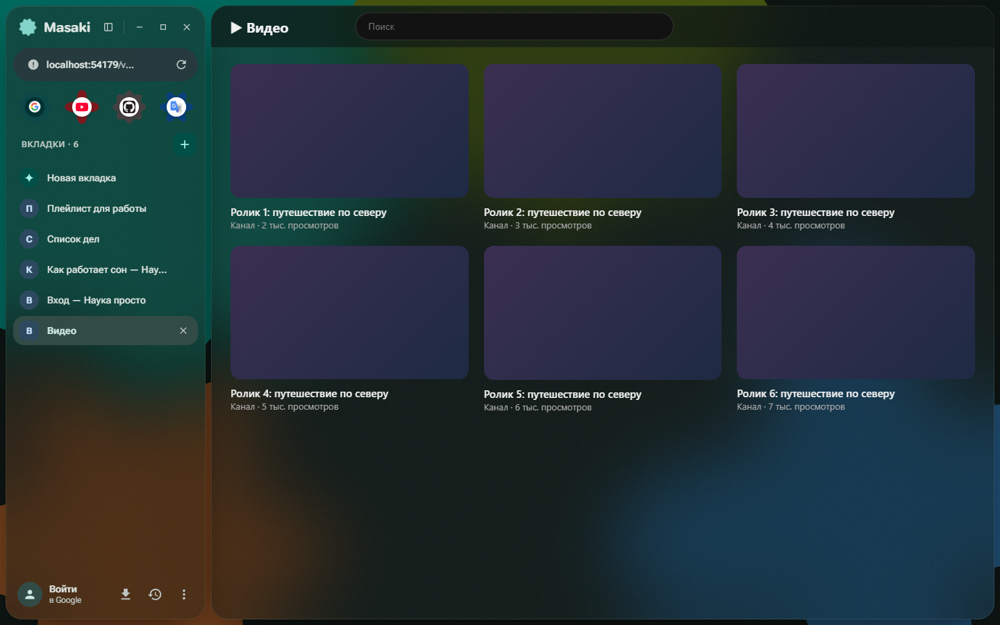
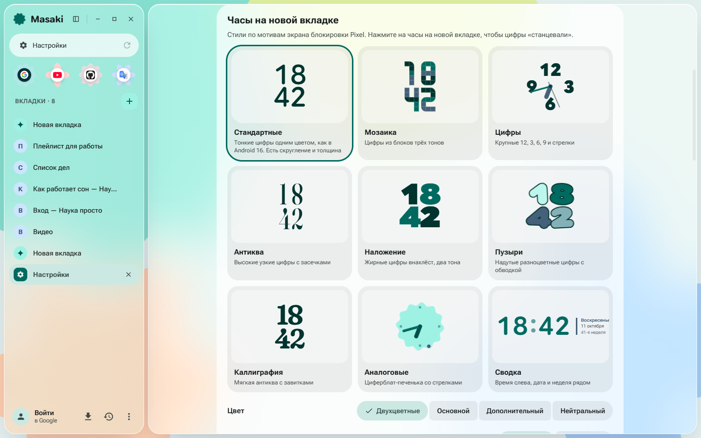

<div align="center">



# Masaki

**Браузер для Windows на Chromium — матовое стекло, Material 3 Expressive и ничего лишнего.**

[](https://github.com/GXUser7/Masaki/releases/latest)


[](LICENSE)



</div>

## Что это

Masaki — браузер со всем, что умеет Chrome, но в своём интерфейсе. Вместо полосы вкладок — тихая
стеклянная панель слева, вместо адресной строки — палитра посередине экрана, а когда нужно место,
панель сворачивается в компактную капсулу внизу. Формы, цвета и анимации — по Material 3 Expressive:
кнопки упруго меняют форму, загрузка — перетекающая фигура, цвета подстраиваются под обои.

<table>
<tr>
<td width="50%"><p align="center"><b>Тихая панель</b> — вкладки, избранное и адрес слева, страница целиком</p></td>
<td width="50%"><p align="center"><b>Капсула</b> — Ctrl+B, и браузер уходит в одну строку внизу</p></td>
</tr>
<tr>
<td><p align="center"><b>Палитра</b> — адрес, поиск, AI Mode и команды через «>»</p></td>
<td><p align="center"><b>Ключи доступа</b> — свой менеджер passkey, вход без пароля</p></td>
</tr>
<tr>
<td><p align="center"><b>Прозрачные сайты</b> — фон сайта становится стеклом панели</p></td>
<td><p align="center"><b>Часы как на Pixel</b> — девять стилей для новой вкладки</p></td>
</tr>
</table>

## Возможности

**Интерфейс**
- Матовое стекло поверх обоев Windows, своей картинки или фигур; тёмная, светлая и системная тема.
- Палитры Material You: готовые, свой цвет или цвет из обоев.
- Новая вкладка как экран блокировки Pixel: часы в девяти стилях, поиск, ярлыки-фигуры.
- Кнопки окна в шапке панели, свои раскладки окна при задержке курсора на «развернуть».

**Вкладки**
- Группы с цветами, превью при наведении, архив давно забытых вкладок.
- Две вкладки рядом с ползунком между ними.
- «Взгляд»: Alt+клик по ссылке открывает её карточкой поверх страницы.
- Мини-плеер для звука из фоновой вкладки, жест «назад/вперёд» по тачпаду.

**Поиск**
- Одна палитра на всё: адреса, подсказки, история, открытые вкладки, команды.
- AI Mode поиска Google — одной кнопкой.

**Пароли и ключи доступа**
- Свой менеджер паролей: автозаполнение, предложение сохранить, перенос из Google Password Manager,
  Chrome, Firefox и Bitwarden (CSV — файл с открытыми паролями Masaki удаляет сам).
- Свои **passkey**: сайт предлагает «Создать ключ доступа» — Masaki создаёт его и потом входит им,
  даже без Windows Hello. Подписывает только главный процесс, страница закрытого ключа не видит.
- Всё хранится зашифрованным Windows (DPAPI).

**Синхронизация через ваш Google Диск**
- Избранное, настройки, история, открытые вкладки других устройств.
- Пароли и ключи доступа — в сейфе, зашифрованном вашей фразой (AES-256-GCM): Google их не прочитает.

**Музыка**
- YouCloud встроен: SoundCloud, Яндекс Музыка и YouTube Music без расширения — с вашего IP и с входами
  через вкладки Masaki; сайт ложится на стекло Masaki и берёт его палитру.
- Мини-плеер для любого сайта с медиасессией: обложка, название, ⏮ ⏯ ⏭, перемотка, цвет из обложки.
- В палитре: «Найти в YouCloud», пауза и переключение треков.

**Аддоны**
- Прозрачные сайты (как моды Zen), блокировщик рекламы на фильтрах Ghostery,
  распакованные расширения Chrome.

## Установка

1. Скачайте `Masaki-Setup-*.exe` со страницы [релизов](https://github.com/GXUser7/Masaki/releases/latest).
2. Установщик не подписан сертификатом, поэтому Windows может показать «Windows защитила ваш компьютер».
   Нажмите **Подробнее → Выполнить в любом случае**. Контрольная сумма SHA-256 — в описании релиза.
3. Masaki ставится в профиль пользователя (права администратора не нужны) и создаёт ярлыки
   на рабочем столе и в меню «Пуск».

Данные браузера лежат в `%APPDATA%\Masaki` и при удалении программы остаются.

<details>
<summary><b>Как включить синхронизацию</b></summary>

<br>

Chrome Sync закрыт для сторонних браузеров, поэтому Masaki хранит данные в скрытой папке
приложения на **вашем** Google Диске (доступ только к ней, остальные файлы не видны). Нужен свой
ключ OAuth — это бесплатно и делается один раз:

1. В [Google Cloud Console](https://console.cloud.google.com/) создайте проект и включите **Google Drive API**.
2. Настройте экран согласия (тип External, доступ `drive.appdata`) и нажмите **Publish app** —
   иначе вход слетает через неделю.
3. Создайте OAuth-клиент типа **Desktop app** и скачайте JSON.
4. В Masaki: **Настройки → Синхронизация → Выбрать файл ключа…**, затем **Войти через Google**.

Пароли и ключи доступа включаются там же отдельно — по фразе, которую знаете только вы.
</details>

## Горячие клавиши

| Клавиши | Действие |
|---|---|
| Ctrl+K, Ctrl+L, Alt+D, F6 | палитра: адрес, поиск, AI Mode; «>» в начале — команды |
| Ctrl+Shift+A | поиск по вкладкам и архиву |
| Alt+клик по ссылке | «взгляд»: открыть ссылку поверх страницы |
| Свайп двумя пальцами по тачпаду | назад / вперёд |
| Ctrl+B | свернуть/развернуть боковую панель |
| Ctrl+T / Ctrl+W / Ctrl+Shift+T | новая / закрыть / вернуть закрытую вкладку |
| Ctrl+Tab, Ctrl+1…9 | переключение вкладок |
| Alt+← / Alt+→, кнопки мыши | назад / вперёд |
| Ctrl+R, F5 / Ctrl+Shift+R | обновить / без кэша |
| Ctrl+F, F3 | найти на странице |
| Ctrl+= / Ctrl+− / Ctrl+0 | масштаб |
| F11 / F12 | полный экран / инструменты разработчика |
| Ctrl+, | настройки |

## Конфиденциальность

Телеметрии нет. Сам Masaki обращается только к Google — за подсказками поиска, значками сайтов
и списком аккаунтов, в которые вы вошли, — а ещё к вашему Google Диску (если включена
синхронизация) и к спискам фильтров Ghostery (если включён блокировщик). Пароли и cookie Chrome
Masaki не читает: перенос паролей — только через экспорт, который делаете вы.

## Сборка из исходников

Нужны Windows 10/11 и Node.js 22+.

```bash
npm install
npm run dev        # разработка: интерфейс перезагружается на лету
npm run pack       # dist/win-unpacked/Masaki.exe
npm run dist       # установщик dist/Masaki-Setup-*.exe
```

Тесты (Playwright, каждый — во временном профиле):

```bash
npm run typecheck
npm run smoke           # основной сценарий, снимки окна в test-output/
npm run test:addons     # аддоны и функции Chrome в контекстном меню
npm run test:import     # перенос из Chrome на подставной папке Chrome
npm run test:sync       # синхронизация через подставной Google
npm run test:passwords  # менеджер паролей и его шифрованная синхронизация
npm run test:passkeys   # ключи доступа: создание, вход, подписи, синхронизация
npm run test:youcloud   # YouCloud: мост, мини-плеер, поиск из палитры (нужен дев-сервер YouCloud/web)
npm run perf            # плавность сворачивания боковой панели
npm run screens         # снимки для этого README (docs/screens)
```

Как всё устроено, принятые решения и грабли, на которые уже наступали, — в [AGENTS.md](AGENTS.md).

## Лицензия

[GNU GPL v3.0](LICENSE). Можно пользоваться, изучать, менять и распространять, но изменённые версии
тоже должны выходить с открытым кодом под той же лицензией.

## Дальше

- Android-версия (Kotlin + Compose + GeckoView) с той же синхронизацией.
- Вход по ключу доступа с телефона по QR, кнопки расширений Chrome, автообновление.

<div align="center">
<sub>Electron · React · TypeScript · Material 3 Expressive</sub>
</div>
